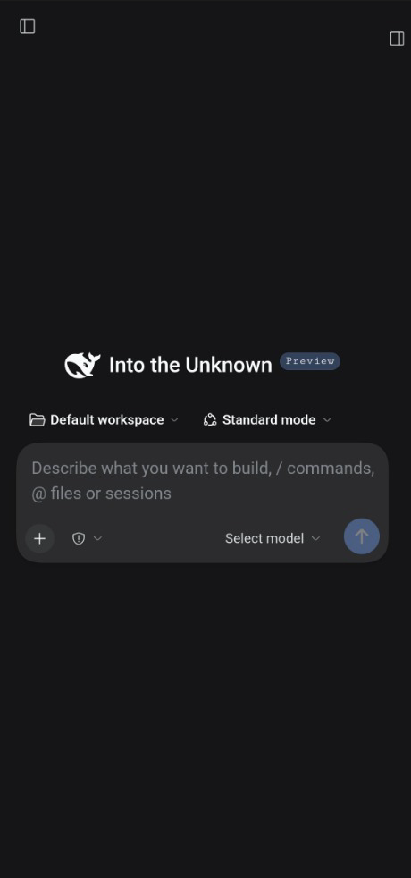
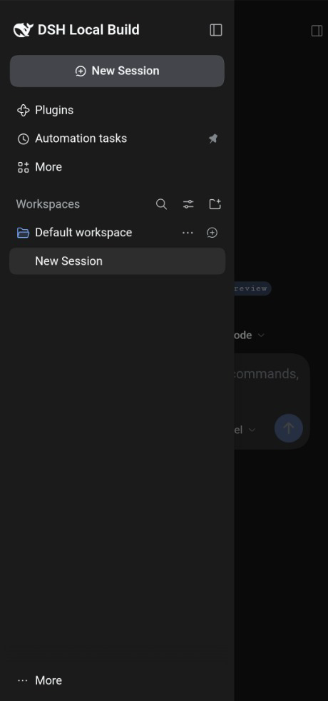
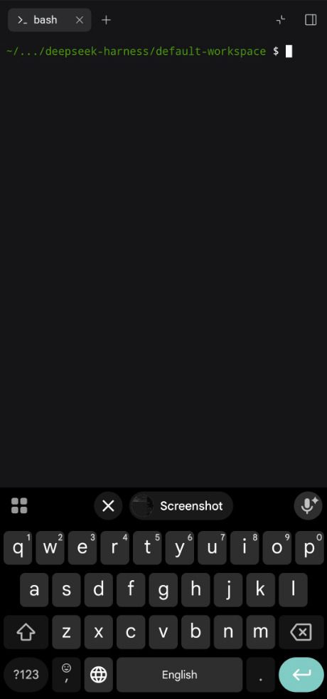

# DeepSeek for Android

**Autonomous DeepSeek AI coding environment running natively on Android with Termux userspace.**

---

### Overview

**DeepSeek for Android** brings the power of **DeepSeek Harness** directly to mobile devices.

No PRoot, chroot, or virtualization overhead. DeepSeek runs **bare-metal inside native Android userspace (Bionic)** powered by an integrated Termux bootloader. Driven by DeepSeek V3 and R1 reasoning models, the agent inspects repositories, authors code across multiple files, compiles binaries, and runs tasks completely on-device.

### App Previews

  
  
  

  Agent Chat &bull; Workspaces &amp; Sessions &bull; Integrated Terminal

### Architecture

- **App Shell:** Native Android application host (`com.dsh`) with foreground service supervisor and hardware integration.
- **Engine Runtime:** DeepSeek Harness Node.js agent runtime running bare-metal via Termux userspace.
- **Bootloader:** Self-extracting Termux Bionic userspace environment with bash, coreutils, python, and git.
- **Web UI:** Full-featured reactive web interface loaded directly in the hardware-accelerated WebView.

### Building via GitHub Actions CI

All release APKs are automatically built and published via GitHub Actions.
To trigger a build:
1. Navigate to **Actions** -> **Build and Release DeepSeek APK**
2. Click **Run workflow**
3. Download the APK matching your device:
   - `deepseek.apk` — Universal (`arm64-v8a` + `armeabi-v7a`)
   - `deepseek-arm64-v8a.apk` — 64-bit ARMv8-A+ split
   - `deepseek-armeabi-v7a.apk` — 32-bit ARMv7-A split
